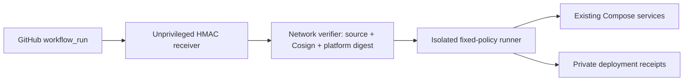

# Compose CD Engine

A small, policy-driven deployment engine for **existing Docker Compose services**.
GitHub builds and signs; your server independently verifies and deploys pinned
platform digests. No SSH key or Docker credentials are given to application CI.

**Early-stage software.** The core originated in a working private deployment;
this reusable image packaging has its own CI. A green engine build is not proof
of a successful application deployment. Single-instance updates may interrupt
requests. The runner has host-admin-equivalent Docker socket access.

## Architecture



- Receiver: repository identity, approved branch/workflow, HMAC, age/replay checks.
- Verifier: no Docker socket or production volumes; independent GitHub/OCI checks.
- Runner: no network, only approved services/images; monotonic candidates, global
  lock, disk preflight, selective snapshots, media-preserving rollback and actual
  image verification. It uses the host Docker daemon through its socket.
- One image, three roles. Installing Docker/Cosign binaries does **not** grant
  access; mounts, UID/GID and network boundaries control each role's authority.

## Restricted NAS management (pilot)

Optional [NAS management API](docs/nas-management.md) exposes only administrator-
approved project/actions: status, log severity summaries, fixed readiness checks,
start/stop/restart and verified-update requests. No SSH, Docker credentials,
arbitrary commands or Compose changes are given to the caller. NAS backups stay
outside the engine. DSM integration and application pilots require real-device
validation; this is not yet production NAS support.

## Engine vs. deployment

| Public engine repository | Your private operations repository / server |
|---|---|
| Python source, tests, image pipeline, generic examples | Real source/target/route policies and private overlays |
| Digest-pinned Python/Docker bases and Cosign checksums | Webhook secrets, application `.env`, scan fingerprints |
| MIT license, installation and protocol docs | Candidate/receipt branches, host inventory, backups |

No real deployment inventory, production state or former repository history is
included here. Never put a production overlay or state into the engine build
context. Application builds, engine builds and deployment configuration evolve
independently. Engine CI never deploys itself or your applications.

## Image development and releases

Push/PR CI runs Python 3.12 tests, public-tree checks, Compose validation and a
native packaged-image smoke test. Trusted pushes additionally publish
`linux/amd64` + `linux/arm64` images to
`ghcr.io/kurisu-agi/compose-cd-engine`, with SBOM/provenance and a separate
keyless Cosign signing job.

- `edge`: latest main build, for evaluation only.
- `sha-<full-commit>`: source identity tag, still resolve/pin its digest.
- `v*`: maintainer-created release tags, when an explicit release is ready.
- Production: verify the signature and pin an approved index/platform digest;
  never automatically track `edge` or auto-update the engine from its own webhook.

See [installation and upgrades](docs/installation.md),
[configuration/protocol](docs/configuration.md), and [security](SECURITY.md).

## Development

Requires **Python 3.12+** and Linux for actual daemon/Compose operation. Tests can
run on macOS with a compatible Python. No Python third-party packages are needed.

```sh
python3 -m unittest discover -s tests -v
python3 scripts/generate_workflows.py --check
python3 scripts/check_public_tree.py
```

Registry-check workflow generation is optional tooling for your **operations
repository**, not a scheduler for this public engine repository:

```sh
python3 scripts/generate_workflows.py --config /path/to/ops/config/projects.json --output-dir /path/to/ops/.github/workflows
```

Copy the registry helper scripts and `shared/` into that operations repository;
generated workflows expect those files there. The empty `config/projects.json`
in this repository deliberately enables no project jobs.

## License

[MIT](LICENSE). See [third-party notices](THIRD_PARTY_NOTICES.md) for separately
licensed image components. Issues and contributions are welcome; see
[contributing](CONTRIBUTING.md). This is not an independently audited product.
